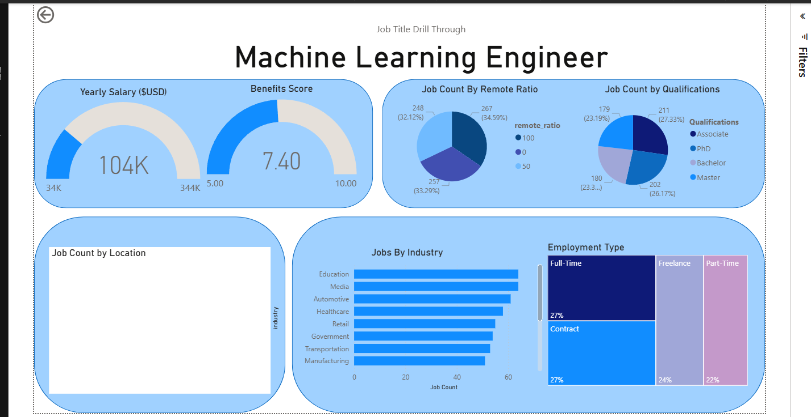
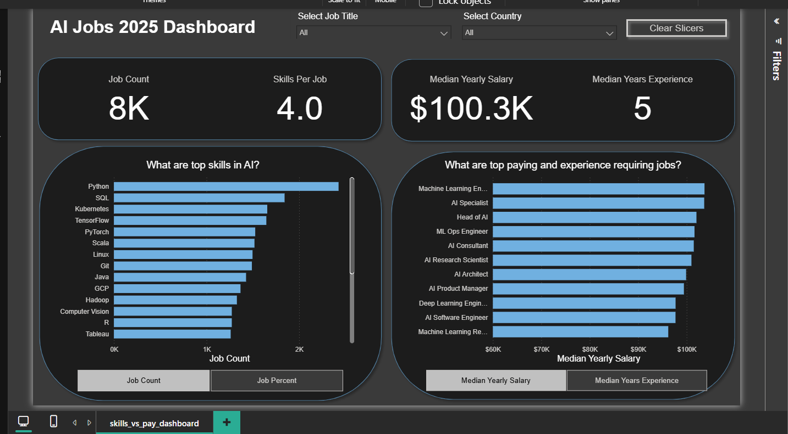

# 📊 AI Jobs Analytics Dashboard — Power BI, Power Query & DAX

This project uses **Power BI** to turn an 8.2K-record AI jobs dataset into interactive reporting on job demand, compensation, skill requirements, and experience. The focus is not only on building visuals, but on preparing the source data in **Power Query** and defining reusable reporting logic with **DAX**.

---

## 🚀 Project Overview
The purpose of this project is to answer two key questions for **job seekers and professionals in AI**:

1. **What problem does this solve?**  
   Information on AI job roles is scattered across multiple platforms. This project centralizes insights about salaries, required skills, and job quality into one easy-to-use dashboard.

2. **Who is this for?**  
   - Students & job seekers exploring AI/data careers  
   - Professionals considering role transitions  
   - Recruiters and hiring managers analyzing skill trends  

---

## 🧱 Data Preparation & Model Layer

The reporting workflow separates source-data preparation from the calculations shown to users.

- **Power Query** cleans and shapes the source job records before they reach the report layer.
- **DAX measures and parameters** define reusable calculations for metrics such as job count, compensation, and experience rather than hard-coding values into individual visuals.
- **Slicers** let users change the report context by job title and country, while **drill-through pages** carry that context into detailed role-level analysis.
- The two `.pbix` files in this repository contain the working Power BI reports, so the underlying report design can be inspected directly in Power BI Desktop.

This structure makes the dashboard easier to explore and keeps the reporting logic separate from the raw source data.

---

## 📂 Repository Structure
- **`ai_job_dataset.csv`** → Dataset used to build the dashboards  
- **`dashboard_1_josh_project.pbix`** → Main AI Jobs Dashboard  
- **`dashboard_2_josh_project.pbix`** → Skills vs. Pay Dashboard  
- **`images/`** → Exported dashboard visualizations for quick preview  
- **`README.md`** → Documentation  

---

## 🖼️ Dashboard Visualizations

### **1️⃣ AI Jobs Dashboard 2025 (Overview Page)**
- Total Job Count: **8.2K**  
- Median Yearly Salary: **$100K**  
- Median Years of Experience: **5**  
- Job Trends (2024 → 2025)  
- Scatterplot: Experience vs. Salary  
- Highest Paying AI Jobs  

.png)

---

### **2️⃣ Drill-through Example (Machine Learning Engineer)**
- Salary: **$104K**  
- Benefits Score: **7.4/10**  
- Job Count by Remote Ratio & Qualifications  
- Jobs by Industry & Employment Type  
- Geographic Job Distribution  

---

### **3️⃣ Skills vs. Pay Dashboard**
- Top AI Skills (Python, SQL, TensorFlow, PyTorch, Kubernetes, etc.)  
- Average Skills per Job: **4.0**  
- Median Yearly Salary: **$100.3K**  
- Top Paying & Experience-Heavy Roles  

---

## 🔑 Key Insights
1. **Python dominates** – Python is the most demanded AI skill, followed by SQL, TensorFlow, and PyTorch.  
2. **Stable salaries** – Median compensation across AI roles is around **$100K** with ~5 years of experience.  
3. **Machine Learning Engineers lead** – They consistently top both job count and salary rankings.  
4. **Remote flexibility** – Around **⅓ of AI roles** allow remote work.  
5. **Skill stacking is critical** – On average, jobs list **4 skills per role**, often mixing programming, cloud, and ML frameworks.  

---

## ⚙️ Technical Details
- **Reporting platform:** Microsoft Power BI
- **Source data:** `ai_job_dataset.csv` with approximately 8.2K job records
- **Data preparation:** Power Query
- **Reporting logic:** explicit DAX measures and parameters
- **Interaction design:** slicers and drill-through pages
- **Visuals:** KPI cards, bar charts, line graphs, scatterplots, and matrix tables  

---

## 📌 How to Use
1. Clone/download this repository  
2. Open `.pbix` files in **Power BI Desktop**  
3. Interact with the dashboards:  
   - Use slicers for **Job Title** and **Country**  
   - Drill-through to analyze specific job roles  
   - Explore skill requirements, salary comparisons, and job quality  

---

## 🙌 Acknowledgements
This project demonstrates how **data analytics and visualization** can uncover valuable insights about the **AI job market**.  
Designed and developed end-to-end in **Power BI**.
